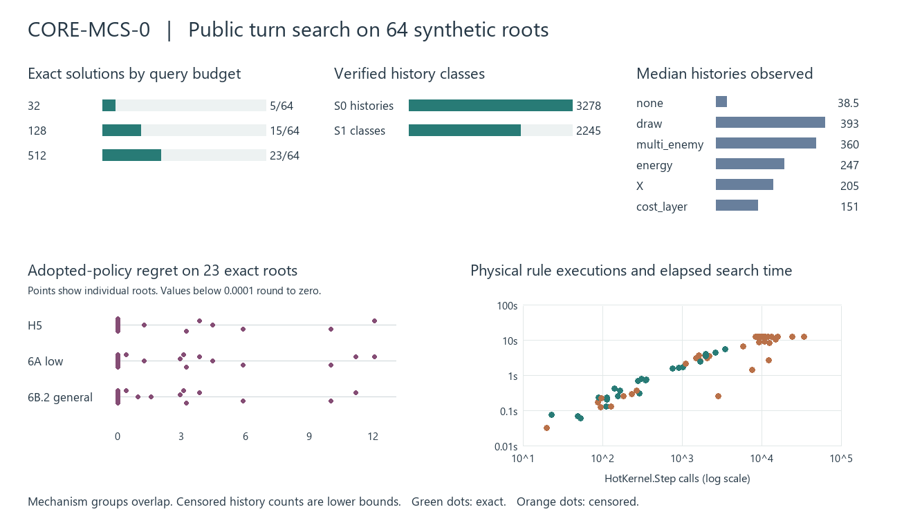

# CORE-MCS-0　机制压缩搜索复杂度普查

64 个合成公开回合根中，根菜单只有 **4–18 个合法动作，中位数 8**。沿合法顺序、目标和公开观察逐层展开后，在本轮预算内有 **23/64（35.9%）** 得到冻结 V2 意义下的精确解。它们的完整回合树含 10–490 个决策历史，中位数 86。其余 41 根只有规模下界。最大的已观察树有 2,646 个决策历史和 19,723 个菜单动作，仍未闭合。完整树证明显示，约三成历史可以合并；已知等价关系后，规则执行的实测降幅为 19.1%。[逐根数据与统计](../experiments/m1-core-mcs0/evidence/results.json)

## 范围与口径

CORE 以 `4143e8fb3cd64bc60cba6f8e6b28014d0778a6a3` 为起点，使用 INFRA `80ca8165fee768ba4e2b55bfd367ee00df650616` 的 H5。40 个历史诊断根加 24 个来自 6A 开发轨迹的新族，共 62 个不同构筑族。新增根按族散列和幕、遭遇类型轮取，普通、精英、Boss 各 8 根。全部 64 根按幕为 22/25/17，牌组 12–25 张，手牌 5–9 张，能量 3–4。每步核对公开前缀、菜单、信念计数顺序与根身份，共重放 648 个实际前缀动作。样本来自合成构筑的冻结策略轨迹，40 根有诊断选择偏向；总体解出比例只描述这块面板。原始牌组、种子、遗物、能力、敌方状态、前缀和根观察随证据交付。[协议](../experiments/m1-core-mcs0/protocol.md) · [冻结面板](../experiments/m1-core-mcs0/evidence/panel.json) · [恢复输入](../experiments/m1-core-mcs0/evidence/roots.gz)

**S0 的计量单位是公开观察及行动历史。** 同一菜单里的不同牌实例、目标、选择、EndTurn 各占一边。H5 每次从 PublicRoot 重建公开状态，沿指定历史行动；其它观察在普通菜单结束回合、待选取合法首项。关闭的整棵程序给出带游标的叶及概率。将每个子游标的叶质量除以父游标质量，得到该动作下的条件分布。重复获得同一转移时核对概率。任何有缺口的程序都不给树贡献已证明的转移。缓存的是已证历史边，搜索继续枚举其余动作。宿主的随机积分处理敌方行动、抽牌及已支持的其它随机；只有观测到信息后才允许分支决策。[适配器](../experiments/m1-core-mcs0/survey.py) · [冻结 H5 搜索实现](https://github.com/matrix773768/sts2-cli/blob/80ca8165fee768ba4e2b55bfd367ee00df650616/engine/HotSearch/TurnSearch.cs)

每个动作先积分，再在同一公开历史上最大化。真实失败为 −50，胜利依战斗初始 HP、最大 HP 与实际终局 HP 调用冻结 payoff；C 截在敌方结算后、下次初始抽牌前，由冻结 V2 评价。只有全部合法行动、条件质量和递归后继都已解决才报告 J*。23 个完整根再次用原生菜单签名逐查询复核，其中 5 根发生过随机事件。对有已知合法策略的 57 根，另将动态规划拼出的策略交还 H5 做整程序积分，价值在 0.0001 内一致。其余 7 根无可比较闭合参考。此认证限于 H5 支持的公开规则和单回合效用。[证书算法](../experiments/m1-core-mcs0/certificate.py) · [复查与策略回放](../experiments/m1-core-mcs0/evidence/review.json)

## 原始树大小与删失

校准时 ordinary-01 只需 46 次程序查询、141 次物理执行。B2 用约 10 秒做了 118 次查询、8,467 次物理执行仍未解尽。因此正式预算冻结为 32、128、512 次指定历史动作的查询，每根搜索 12 秒软限，每程序最多 128 次规则执行。一次查询也可能证明多个默认后续边。三个截面使用同一次展开；早到时间上限的根以原状态进入更高预算的分母。[校准数据](../experiments/m1-core-mcs0/evidence/pilot) · [正式参数](../experiments/m1-core-mcs0/panel.json)

| 累计逻辑查询上限 | 32 | 128 | 512 |
|---|---:|---:|---:|
| 完整根 / 全部 64 根 | 5 | 15 | 23 |
| 完整率 | 7.8% | 23.4% | 35.9% |

| 当前合法菜单的公开特征（可重叠） | 根数 | 完整 | 根菜单中位数 | 已见历史中位数 | 已见菜单动作边中位数 | 物理执行中位数 |
|---|---:|---:|---:|---:|---:|---:|
| 全部 | 64 | 23 | 8 | 188.5 | 512 | 1,970 |
| 抽牌变量 | 25 | 3 | 8 | 393 | 1,336 | 9,367 |
| 多敌 | 39 | 10 | 9 | 360 | 809 | 2,663 |
| 能量变量 | 14 | 5 | 7.5 | 247 | 611 | 2,376.5 |
| X 费 | 8 | 3 | 9 | 205 | 690 | 1,469 |
| 活跃费用层 | 2 | 1 | 11 | 151 | 623 | 845 |
| 无上述标志 | 10 | 7 | 6 | 38.5 | 89.5 | 154 |

闭合根的完整合法动作边范围为 19–979，中位数 171。单看 24 个新增开发根，7 个完整，观测历史中位数 130，动作边中位数 384；历史 ordinary 组为 9/12。分组按根上可见字段，抽牌、能量变量只是代理特征，不能识别全部自定义转化、减费、抽牌禁用或后续循环。删失根的整树上界未知。这些差异同时受根选择、随机支持和遍历次序影响。[根级分层与分布](../experiments/m1-core-mcs0/evidence/results.json)

41 个删失根中，30 根遇到未建模随机，17 根达到墙钟上限，17 根有程序触及物理步数上限，10 根触及逻辑预算。原因可重叠；仅未建模随机即有 11 根。15 根遇到自定义卡牌执行的随机缺口，随机活敌选择和自动出牌各涉及 7 根。正式面板的显式深度截断、其它非随机机制报错、恢复失败、执行异常均为 0。冻结宿主仍有深度上限；未建立通用循环证明，也没有设定内存截断。开放程序的缺失质量按查询及原因保存在原始收据中。[逐根原始查询与转移](../experiments/m1-core-mcs0/evidence/panel)

## 压缩、规则执行与夹具反例

**在 23 个已闭合 H5 根上**，S1 从叶向根比较完整公开观察、按合法索引排列的全部条件转移、后继等价类和边界身份。C 身份包含完整导出的 C 事实及待抽数量；终局包含导出的终局字段。相同 V2 编码、战术向量、数值或单独观察哈希均不能触发合并。3,278 个历史收敛成 2,245 个可证明等价的决策类（减少 31.5%）。这里没有物理状态逐字节比较；无法分解“物理完全相同”和“不同内部表示但行为相同”的数量。同类中按相同条件后继分布再合并动作，得到保守的 S2 动作等价子集。

| 已知有限树证书的同根复用实验 | 需要覆盖的动作类 | 程序查询 | 实际规则执行 | 实测秒 |
|---|---:|---:|---:|---:|
| S0 保留历史和实例 | 6,411 | 3,156 | 17,179 | 27.48 |
| S1 复用已证等价历史 | 4,760 | 2,538 | 14,324 | 23.35 |
| S1 再合并相同作用的合法动作 | 4,672 | 2,450 | 13,895 | 22.25 |

三臂采用相同历史/动作顺序，轮换运行次序，实际调用相同 H5 与 V2，核对代表边的转移。S1 少执行 2,855 步；动作合并再少 429 步。秒数包含从已记录的树计算签名、发起查询及评价，排除根恢复。**证书本身依赖此前的全树探索**。19.1% 是同根证书复用时的实际执行节省，新根在线首次求解的净提速仍待验证。S2 的 88 个等效动作类差额不能全部归于交换次序；一般交换律没有在线部署。[复用实现](../experiments/m1-core-mcs0/compression.py) · [逐根实测](../experiments/m1-core-mcs0/evidence/compression.json)

**旧 CORE-1R2 宿主单列。** 从 16 个归档夹具提取每个合法停牌点的完整导出状态及抽牌信念。对 basic、多目标和升级三棵有限树，逐节点核对边与合法菜单，S1 比较同观察及完整后续子树。S2 对相同牌型/升级/目标选择代表并固定顺序；S3 枚举预算内的牌型计数及目标分配，在归档树绑定合法动作。S3 衡量有限分配表达，仍借用原树验证执行。

| 夹具 | 原始决策历史 | S1 类 | S2 规范路径数（含空序列） | S3 分配尝试 | S3 覆盖的完整停牌状态 |
|---|---:|---:|---:|---:|---:|
| 基础攻防 | 86 | 9 | 9 | 10 | 9/9 |
| 双目标攻防 | 287 | 19 | 19 | 20 | 19/19 |
| 含升级牌 | 86 | 23 | 19 | 35 | 19/23 |

升级夹具有等攻防但剩余手牌排列不同的路径。固定同类实例代表会遗漏可见的后续绑定，四个缺失状态足以否定严格集合相等。规范顺序及分配原型的无损结论仅限前两个夹具和所比较的停牌口径；含升级牌降级为近似。旧宿主自身的 reduced 在升级夹具只保留 9/23 个完整停牌状态，在力量、敏捷、易伤和 Headbutt 夹具也各漏 4、4、1、7 个。力量先于攻击、强牌优先、按弃牌属性重绑定及睡眠集均须各自验证。归档的末敌反应、临界遗物、普通抽牌、耗尽生成、HP 换能/X 费继续作为机制回归。旧宿主的归档树对待选及随机有停车点；这些夹具不能证明 HotSearch 上的 V2 等价。原归档基础/双目标的物理调用分别为 85→8、286→18，只能在各自旧宿主臂之间比较。[夹具分析和原图入口](../experiments/m1-core-mcs0/fixtures.py) · [16 项结果与反例签名](../experiments/m1-core-mcs0/evidence/fixtures.json)

## 冻结策略的价值覆盖

在每个相同公开根实际调用 H5 tactical32＋V2、6A low、6B.2 general，保留参考、候选、不可评价质量、程序摘要、所选程序和单程序步数。包含参考在内分别有 2,136、376、445 项。历史 40 根三臂的候选数、所选位置、闭合资格及闭合值与原归档一致；enemy-07/general 的开放参考有一次未建模随机原因细分变化，总缺口质量仍为 1。完整根的候选最优与实际采用值一致。[同根 S4 与原始搜索](../experiments/m1-core-mcs0/evidence/panel) · [历史对照](../experiments/m1-core6b2/evidence/regression.gz)

| 23 个完整根，实际采用相对 J* | 平均后悔 | 中位数 | 最大 | 差值 > 0.0001 的根 |
|---|---:|---:|---:|---:|
| H5 tactical32＋V2 | 1.775 | 0 | 12.080 | 8 |
| 6A low | 2.543 | 0.0112 | 12.080 | 14 |
| 6B.2 general | 1.878 | 0.0007 | 11.195 | 12 |

| 41 个删失根，相对最高已验证策略的经验差 | 可比候选根数 | 候选最优平均差 | 实际可比根数 | 实际采用平均差 |
|---|---:|---:|---:|---:|
| H5 tactical32＋V2 | 34 | 6.586 | 13 | 8.041 |
| 6A low | 13 | 4.600 | 13 | 4.600 |
| 6B.2 general | 13 | 1.322 | 13 | 1.322 |

经验参考取正式预算下搜索得到并回放的条件策略和三臂闭合程序的最大值。它受候选来源影响。28 根参考开放，其中 21 根 H5 菜单内已有闭合候选；low 和 general 按原门控回退。开放回退没有冻结期望值，门控损失在这 28 根上不可识别；闭合参考的门控损失为零。每种方法的候选与实际采用各有独立分母。后加的 B2 调度实验独立报告，不更改预定面板的经验参考。[逐根后悔和分母](../experiments/m1-core-mcs0/evidence/results.json)

**四个人工根均删失。** A 的所有比较侧开放。B1 搜索得到 61.456，H5/low/general 实际为 29.069/61.320/61.320。B3 的搜索闭合策略为 −12.271，三臂均遇到开放参考。B2 的正式广度优先搜索只找到 −12.544；三臂分别得到 1.069、−0.863、41.756。后者执行岿然不动、全身撞击右敌、铁斩波中敌。

B2 另做调度敏感性实验。只继续扩展已证转移中唯一、质量为 1 的公开决策后继，保留每个所选菜单的所有目标。它改变探索范围，有多后继或缺口时跳过后续。582 次查询、31,125 次规则执行后，自动找到 **49.355** 的程序：打击左敌、岿然不动、全身撞击右敌、结束。宿主实盘绑定四步成功，三个敌人剩余 HP 依次为 41、15、0。调度不读取敌名、牌名和目标偏好；这个结果证明该通用子空间能自然产生并评价右敌路线。B2 未获全树证书，S1/S2 的全局收益和 S3 在该根的等价性仍未知。[调度实验](../experiments/m1-core-mcs0/b2.py) · [公开绑定见证](../experiments/m1-core-mcs0/evidence/b2-trace.json)

## 剩余复杂性与接口缺口

正式 S0 搜索共 13,269 次查询、340,464 次物理规则执行、89,947 次 NeedsChance 停车、5,825 次 NeedsChoice 停车，搜索墙钟 315.23 秒；含恢复、S4 和运行开销的总阶段为 336.77 秒。在已证的一步条件转移中，1,465 个历史动作有多个公开结果，共 5,892 条结果边；中间连续随机事件可能汇合在同一公开结果。随机停车另计物理次数。全体根各自去重后合计得到 8,019 个闭合程序 C 身份、17 个终局身份。V2 请求 66,167 行、8,669 个非空请求批次；正式运行未采缓存未命中数。完整根重复验证单独测得 819 行实际推理和 3,807 行缓存复用。H5 进程峰值 169.6 MiB；Python 和宿主总峰值、内部快照复制数没有计数器。每次 search 重建一次 PublicRoot，树内每个策略查询从根重放；这些成本已进入物理步数。各根的完整条件转移（含质量）、程序查询、规则步数和峰值在原始收据可查。[计算账本](../experiments/m1-core-mcs0/evidence/ledger.json)

- **随机支持是已观测到最广的闭合障碍。** 41 个删失根里有 30 根至少一次遭遇未建模随机；即使把预算增大，缺失的概率也不会因此获得证明。抽牌组已见历史及物理成本尤其高。相互重叠的停因使本轮无法给四种复杂性做可加百分比分摊。
- **排列和目标组合具有可消除的成本。** 简单双目标夹具 287 个历史可压缩为 19 个停牌状态；正常根上，带完整后继证书的等价历史占比明显更小。S1 对实测物理调用节省的贡献大于本轮保守动作合并。B2 说明在随机子树提前消耗预算时，便宜的确定性方案也可能延后很久。
- **接口决定一次逻辑扩展的价格。** TurnSearch 内部有父 Snapshot、HotColdSidecar、DrawBelief 和可重入的选择/抽牌前缀。公开根重建只复制通过审计的计数、区域和敌方历史。外部 search 接受一个首动作和公开回调，返回一个已绑定程序的分布；Worlds.Save/Restore 只保留一个稳定实盘 checkpoint，包含私有世界和 RNG，在 prompt 上不能保存。公开 Stamp 是 facts/prompt 的摘要，不能直接担保后继等价；V2 张量缓存只能复用推理。当前 RPC 缺少可持有的公开决策节点句柄、共同父状态的一步全动作/概率展开、完整公开信念键及其语义版本。[公开签名和菜单绑定](https://github.com/matrix773768/sts2-cli/blob/80ca8165fee768ba4e2b55bfd367ee00df650616/engine/HotSearch/Policy.cs) · [实盘 checkpoint](https://github.com/matrix773768/sts2-cli/blob/80ca8165fee768ba4e2b55bfd367ee00df650616/engine/HotSearch/Worlds.cs)
- **机制元数据还不足以静态证明一般交换律。** 旧分类器结合卡牌操作、局部费用和目标、遗物计数、敌方反应、历史及模拟预览。自定义牌可能有空 operations，例如 BODY_SLAM 和 PRIMAL_FORCE。缺少条件读写集合、同型实例身份、触发次序、区域次序依赖以及死亡/能力回调的保守摘要。[历史分类器](../experiments/m1-core1r2/Tactical.cs) · [人工案例规则摘录](../experiments/m1-core6b1/evidence/rules.json)

## 下一阶段架构建议

1. 优先暴露规则侧的公开信念分支接口。在同一父快照上枚举一个合法动作的全部公开观察、条件概率、C/终局或具名缺口，为快照复制、条件重放和实际推理单独计数。首先用本轮 23 个完整根比对全体边、概率、最优值和原生程序绑定，再评估首次求解的净成本。
2. 将严格约简限定在有前置条件的动作对。在无触发、无杀敌、无变费的基础攻防子集，按实例属性和目标分配生成候选；通过换序的双路径检查牌区、费用层、合法动作、概率和完整边界。格挡与全身撞击、力量与攻击、抽牌与后续菜单、转化与费用修改保留读写依赖。遇未知回调时保留两序。升级夹具的四个漏点应进入准入测试。
3. 把确定性组合和随机条件续策分配到同一预算的不同队列，按实测物理成本和已证明概率质量调度。B2 的补充结果支持在全面展开随机前为低成本组合预留预算。用价值函数统一比较候选；对仍开放的参考保留公平采样课题。学习优先处理这些剩余的提案和调度问题。完整能力基线仍为 H5 tactical32＋V2，快速对照仍为 6A low。

复现顺序为 freeze.py、fixtures.py、survey.py pilot、survey.py panel、review.py、analyze.py、compression.py、b2.py、b2_trace.py、figure.py。建根依赖本地 6A 开发轨迹；复核已冻结根可直接从 roots.gz 开始。实测阶段使用独立 H5 部署及既有 PyTorch 权重，纯证据核验运行 verify.py。本轮结束于复杂度普查及架构建议。6B.3、6B.4、6C 和后续机制搜索研究继续保留。[实验目录](../experiments/m1-core-mcs0)
