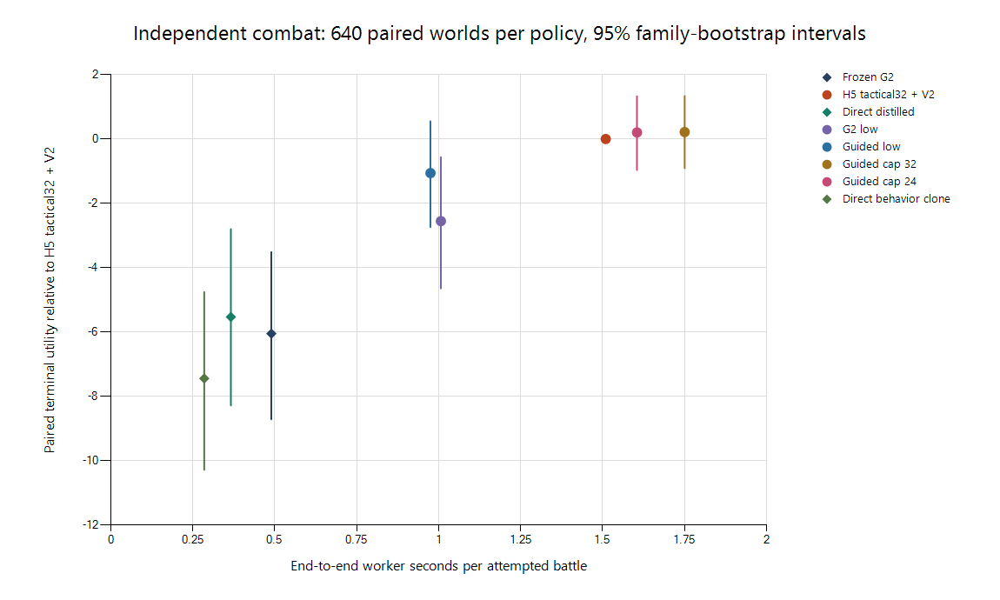

# M1-CORE-6A　学习型策略引导与选择性战术搜索

**学习引导通过低成本主检验，完整搜索能力基线保留 H5 tactical32＋V2。** 在 320 个新构筑族的 640 个配对世界上，低成本引导把每场端到端成本从 1.510 降至 0.975 worker 秒，合格经验吞吐由 36.9 提至 57.6 场/worker 分钟。它取得 284 胜、599 场严格完成，H5 为 290 胜、594 场完成；589 个共同终局的效用差为 −1.06 [−2.74,+0.55]，通过事前的非劣门槛。同成本引导没有获得独立能力升级。相对无学习的低成本搜索，学习引导在 596 个共同终局上取得 +1.48 [+0.05,+2.96]，其中包含排序、选择性扩宽和学习续法的共同作用。

## 实验问题与冻结边界

本轮把 H5 公开轨迹中的搜索知识蒸馏到动态合法菜单评分器，再将评分器用作独立行动策略或完整回合搜索的提案器。价值评价统一为原冻结 V2。CORE 实验资产起点为 `011e9df493450d031dacbf1268eaaa21e38863f4`；实际提交父版本另包含 v2.0 路线图文档 `7961d56`。INFRA 读取工作树为 `80ca8165fee768ba4e2b55bfd367ee00df650616`。5G 和 5H 检查点保留。实验域为 H5 支持的合成 Ironclad 单场战斗。[项目愿景](project-vision-v2.0.md) · [架构规划](m1-core-v2.0.md) · [5H 冻结结论](m1-core5h-decision-and-interaction-learning.md)

## 公开经验与教师资格

H5 发布 `188cda5924b614b6399810c7aad897dafb319de0c66fdb956344e9380bb1a6da` 和 2A 发布 `dc7985a66a7cc0de2ac2a85f5dfa95cd804dc061286e366a7211bb1db43d4bb2` 共享冻结 tactical32＋V2 行为。按发布清单核对原始分片和公开视图哈希，以任务 ID 对齐；逐步核对实际公开菜单索引、牌实例、目标、待选与已执行程序的观察绑定。训练沿用 4,096 个主自然族，开发沿用 275 族；每族一场真实完成战斗，训练有 1,936 胜和 2,160 败、19,936 个实际 C。13 个额外储备族、历史开放与确认族、条件根和独立复评不进入本轮拟合。接受冻结的原生审计协议。训练仅重读现有数据。[来源与分母](../experiments/m1-core6a/evidence/source.json) · [读取与逐步绑定](../experiments/m1-core6a/prepare6.py)

| 实际决策的来源 | 训练 | 开发 | 监督含义 |
|---|---:|---:|---|
| 搜索提交程序的首动作 | 8,214 | 540 | 参考闭合，V2 预测某程序优于参考；程序可与参考共享首动作 |
| 闭合参考获选的首动作 | 6,596 | 460 | 给定候选中无程序超过参考 |
| 参考开放，直接回退的首动作 | 9,164 | 582 | G2 行为模仿 |
| 提交程序 / 参考程序的后续多选行动 | 14,053 / 9,908 | 938 / 694 | 已实际执行的完整程序绑定 |
| 其他直接回退的多选行动 | 22,981 | 1,350 | 无闭合搜索教师 |
| 待选多选，搜索 / 参考 / 回退 | 1,061 / 456 / 1,336 | 66 / 34 / 96 | 实际合法选项与跳过选项 |
| 唯一合法动作 | 21,034 | 1,391 | 更新公开历史，无排序损失 |

训练共有 73,769 个多选菜单、397,146 个合法动作，开发为 4,760 个菜单、25,280 个动作。参考闭合的训练查询有 415,164 个候选程序，其中 368,235 个闭合；数据记录各程序的首动作、战术样式、调用量、概率覆盖和 V2 预估效用，并保存实际采用程序的条件动作图及返回 law。未选程序的全部内部绑定树不能从自然摘要普遍恢复。未闭合分支缺少完整效用。自然终局属于整条行为轨迹；条件真实终局仅用于已有同根程序的独立诊断。

## 策略网络和训练

每个合法动作由同一个 23,505 参数网络评分。输入为 100 个公开数值特征和 16 维牌 ID 哈希嵌入，包括实际手牌槽、升级及当前费用、目标及敌方公开攻击、动作预览、卡牌机制、手牌摘要、资源、待选菜单和 G2 三时标历史的中间时标。逐动作编码为 64→48 隐层，拼接该菜单有效动作编码均值后以共享头输出实数。并列分按合法索引处理。部署和训练复用同一编码函数；隐藏牌序、未来奖励、敌人 ID 及种子不进入评分。牌 ID 哈希及手牌摘要存在碰撞，规则缺失时保留已有公开预览。遇到单一合法动作直接执行。[评分器](../experiments/m1-core6a/policy6.py)

两个固定种子 6119、6233 分别训练行为克隆和搜索蒸馏。每次 AdamW 更新 3,600 步、每步 128 个随机多选菜单，共 460,800 次呈现，初始学习率 0.0015，余弦降至 15%，梯度范数上限 3。行为克隆等权模仿实际动作。蒸馏对搜索、参考、开放首动作的行为损失分别赋权 3、1.1、0.30，对程序后续和待选按来源加权。在有两个以上可估首动作时，把同一首动作不同闭合程序的最高预测效用与参考合并，按温度 2.5 生成软目标；仅在有完整估值的动作间计算交叉熵，系数 0.6。这是策略对搜索选择与候选排序的监督。真实胜负不作动作级信用分配。[精确损失与训练轨迹](../experiments/m1-core6a/train6.py)

在 600、1,800、3,600 步检查开发表现，综合分按搜索提交首选 top-1 / top-2 及全部多选 top-1 加权 50% / 25% / 25%。四臂均选中 3,600 步。正式搜索使用蒸馏 6233。另在确认前锁定克隆 6119 作次要纯行动对照，以检验改变监督后独立行动成本和能力的变化。[蒸馏权重](../experiments/m1-core6a/evidence/distill-6233.pt) · [克隆权重](../experiments/m1-core6a/evidence/behavior-6119.pt) · [主预选](../experiments/m1-core6a/evidence/picked.json) · [次要对照预选](../experiments/m1-core6a/evidence/clone-selection.json)

| 方法、种子 | 所有动作 top-1 | 搜索提交首动作 top-1 / top-2 | 搜索程序后续 top-1 | 搜索待选 top-1 |
|---|---:|---:|---:|---:|
| 克隆 6119 | 63.6% | 33.1% / 55.6% | 57.6% | 71.2% |
| 克隆 6233 | 63.4% | 31.7% / 55.4% | 56.7% | 53.0% |
| 蒸馏 6119 | 58.8% | 37.0% / 60.2% | 61.1% | 71.2% |
| 蒸馏 6233 | 59.2% | 37.6% / 61.9% | 61.1% | 71.2% |

在搜索确实改变首动作的 412 个开发查询上，蒸馏 top-1 为 28.2%，克隆为 18.4%。用低成本模式的提案规则保留参考和结束回合后，蒸馏选取 53.0% 的首动作，覆盖 67.5% 的真实教师首选；克隆取 49.7%，覆盖 56.8%。在全部 1,000 个闭合开发参考上，蒸馏提案覆盖为 86.6%。开放参考的实际动作全是 G2 回退，蒸馏对其 top-1 为 50.3%。

51 个独立条件开发根保留每根四个共同重排世界及单列原世界。40 根的两套完整程序具有不同首动作，22 根四世界平均差非零。在这 40 根以首动作评分二选一，蒸馏、克隆、G2 和 V2 程序估值的平均选择后悔分别为 4.09、3.40、3.28 和 1.79 效用单位；以该根实测较优程序为零后悔。另有 7 个不同首动作的开发复评根，独立四世界上的对应值为 8.61、7.89、9.61 和 0.00。其余同首动作的条件根无法用首动作排序区分两案。这里的终局来自实际执行成对完整程序后恢复原续策；纯策略单步选择后的回报需由整战检验。[逐根真实配对与排序](../experiments/m1-core6a/evidence/teacher-check.json)

## 搜索接口与成本对照

公共接口 `Guide.scores(obs, history, opening)` 为输入菜单逐项返回分数。外部引擎需提供可索引的公开手牌、候选牌、合法动作和目标、玩家与敌方公开资源以及实际动作更新后的历史。程序内的待选沿用同一评分器；新引擎还需实现搜索快照、条件观察到下一动作的绑定、公开概率记账和回退规则，才能复现 H5 完整搜索语义。下一阶段教师可以单独调用评分函数生成提案。特殊机制机会目前仅识别抽牌预览和 X 费用，评分差采用原始 logit 单位。[提案、继续程序与参考接口](../experiments/m1-core6a/search6.py)

交付的独立包内置冻结语义表、权重和公开特征实现，运行依赖 Python、NumPy、PyTorch。解压后从 `core6a` 导入 `PublicGuide`，用 `PublicGuide("guide.pt")` 加载，按 `initial_history → scores / proposals → advance_history` 调用。由宿主传入 `reference` 索引，提案接口保留该动作与结束回合；待选返回合法选项排序。隔离解释器在未加载 HotSearch 的情况下，重放了同一开发轨迹 13 次实际决策，分数与最终历史均与研究实现一致。此项验证的是策略端，外部规则引擎的忠实性仍属独立工作。[可迁移策略包](../experiments/m1-core6a/evidence/public-guide.zip) · [隔离验证与哈希](../experiments/m1-core6a/evidence/portable.json)

- **G2、纯蒸馏、纯克隆**每到行动和待选都在当时的合法菜单直接选首位，均无完整参考闭合门控。
- **H5 tactical32＋V2** 沿用每个合法首动作四种既有战术样式、预算 32、G2 完整参考和零裕量提交。
- **低成本引导**先算原 G2 参考；开放时省略候选搜索并按原 G2 回退。闭合时取学习排序前二，加上参考首动作和结束回合；前二分差小于 0.55 或有上述机制机会时多取一个。各首动作使用 light、guard 两种续法，再为最高分首动作构造一套由学习策略驱动的完整公开后续程序，包括所遇待选。V2 沿真实概率评价所有闭合程序，执行仍需匹配其公开 law。
- **G2 低成本对照**使用相同参考先行、两种战术样式、机制扩展和端回合保护。动作优先级与一个反馈程序使用 G2，扩宽时仅看机制信号。与学习低成本臂的差异包含排序、置信度扩展和反馈续法。
- **同预算引导**在所有合法首动作保留原来每动作四个程序的额度，预算仍为 32；对学习前二以一个学习反馈程序替换 end 样式，保留原 G2 参考。反馈程序访问公开回调，规则上限相同仍可能有额外端到端开销。另在独立确认前，使用相同的 32 个开发世界对同预算、上限 24/48 与先算参考再剪枝的配置作顺序单 worker 计时，按最接近原搜索的时间冻结实际成本匹配对照。[协议](../experiments/m1-core6a/protocol.md) · [预选与调度](../experiments/m1-core6a/campaign6.py)

## 独立确认协议

在同一套自然开发公开菜单上，还可直接比较剪枝前后能保留多少 V2 已知方案。下表限于参考闭合的 1,000 次查询。所有方案都来自原 H5 日志，因此可以分别扣除样式、首动作优先级与宽度的影响。新生成的学习反馈程序留到实际整战评价。

| 原菜单保留方式 | 计算的候选程序 | 保留最高预测效用的查询 | 仍能超过参考的查询 | 每查询最高预测增益 |
|---|---:|---:|---:|---:|
| 全首动作、四样式 | 27,636 | 1,000 | 540 | 3.438 |
| 全首动作、两样式 | 13,818 | 905 | 499 | 3.231 |
| G2 固定宽度、两样式 | 6,448 | 727 | 404 | 2.394 |
| 学习排序、同一宽度规则、两样式 | 6,776 | 795 | 438 | 2.837 |
| 学习排序、低置信度再扩一项、两样式 | 7,678 | 823 | 456 | 2.970 |

同宽度规则下，学习排序比 G2 多保留 68 个最高预测效用，新增 328 个候选程序；保留参考和结束回合后各自去重，实际宽度会略有差异。自适应提案用原候选的 27.8% 保留平均预测增益的 86.4%。这组对照量化了搜索知识压缩，其终局价值由下文的新构筑检验。[按构筑保存的共用菜单消融](../experiments/m1-core6a/evidence/shared-menu.json)

预先按 5D 捐献构筑的章节和来源生成 320 个新牌组，每族两个固定种子。按无序牌组组成排除全部历史、2A 预分配的训练/开发/失败/储备，以及 5G 确认、5H 所有开放和确认族。独立确认按 64 世界分片，预先确定各分片的模型执行顺序，使不同模型分散在相近的系统负载下。5G 的 64 个开放开发世界用于开发与计时；相同 V2 的逐世界胜负、HP、查询、参考闭合和干预同时与 5H 开发收据复核。CORE-0 继续封存。[冻结面板](../experiments/m1-core6a/evidence/confirm.gz) · [生成器](../experiments/m1-core6a/freeze6.py)

全部 640 次尝试均进入各臂的获胜及完成分母。只有双方严格终局才有配对效用。死亡为 −50，存活沿用冻结开战效用；严重战损指死亡或净损达到开战 HP 的一半。效用、全尝试胜率差与完成率差均在同一构筑的两个配对世界一起重采样，重复 10,000 次。低成本主检验事前要求效用差区间下界高于 −3、胜率及完成率差下界均高于 −3 个百分点、每尝试端到端成本至少降低 20%。同成本能力提升另要求效用下界高于零、成本不超过基线 110%、胜数与完成数均不少于基线。克隆直出是确认前冻结的次要对照。[统计与成本口径](../experiments/m1-core6a/results6.py)

生产计时覆盖模型与宿主初始化、全场搜索与执行、落盘压缩的实际公开决策序列和自然 C/终局、读回核对行动及程序绑定、文件哈希。每分钟吞吐是严格完成且通过读回的整场数；只有已完成战斗的实际 C 和行动列入可用量。另记录含 Python 导入的工作时间、单场执行及公开导出时间。跨引擎的发布调度、远程存储、原生复审费用不在这次本机测量中。纯策略仅用 H5 执行其实际动作，不产生完整候选 law；其完整行为经验与候选搜索教师经验分别解读。[执行及公共轨迹写出](../experiments/m1-core6a/battle6.py)

## 独立能力与成本曲线

320 个构筑族共覆盖 68 种遭遇，三章分别有 226、206、208 个世界。表中每行均尝试 640 场。翻赢、翻输及同胜战损差均以 H5 tactical32＋V2 为对照；负的同胜净损差表示节省 HP。净损与严重场数使用各臂自身的严格完成面板。

| 策略 | 胜 / 全尝试 | 严格完成 | 平均净损 / 严重场数 | 双方共同终局 | 配对效用差 [按族 95% 区间] | 翻赢 / 翻输 | 同胜净损差 |
|---|---:|---:|---|---:|---|---|---:|
| 冻结 G2 | 269（42.0%） | 626（97.8%） | 49.24 / 499 | 594 | −6.05 [−8.71,−3.51] | 12 / 38 | +3.71 |
| 纯行为克隆 | 257（40.2%） | 622（97.2%） | 49.45 / 493 | 590 | −7.44 [−10.28,−4.75] | 15 / 50 | +3.64 |
| 纯搜索蒸馏 | 272（42.5%） | 617（96.4%） | 49.35 / 500 | 590 | −5.53 [−8.28,−2.80] | 20 / 40 | +4.90 |
| G2 低成本搜索 | 274（42.8%） | 601（93.9%） | 47.62 / 465 | 588 | −2.55 [−4.64,−0.56] | 7 / 19 | +0.73 |
| **学习低成本搜索** | **284（44.4%）** | **599（93.6%）** | **46.93 / 457** | **589** | **−1.06 [−2.74,+0.55]** | **10 / 15** | **+0.18** |
| H5 tactical32＋V2 | 290（45.3%） | 594（92.8%） | 46.51 / 440 | 594 | 0 | — | — |
| 学习引导上限 24，实测成本匹配 | 290（45.3%） | 596（93.1%） | 46.56 / 441 | 592 | +0.20 [−0.96,+1.33] | 7 / 6 | −0.11 |
| 学习引导上限 32，同程序预算 | 290（45.3%） | 592（92.5%） | 46.44 / 436 | 591 | +0.22 [−0.91,+1.34] | 7 / 6 | −0.15 |

八臂共同完成 580 个世界。仅在这组完全相同的世界上，学习低成本相对 H5 的平均效用差为 −1.07，G2 低成本为 −2.59，纯蒸馏为 −5.63，上限 24 和 32 分别为 +0.20、+0.22。全尝试胜场另按全部 640 场计算。所有失败保留原状态和原因。[独立逐臂结果、共同面板和统计判定](../experiments/m1-core6a/evidence/results.json)

| 策略 | 端到端秒/尝试 | 模型与宿主加载至核验秒/尝试 | 合格完整战斗/worker 分钟 | 合格 C/worker 分钟 |
|---|---:|---:|---:|---:|
| 冻结 G2 | 0.490 | 0.365 | 119.9 | 559.6 |
| 纯行为克隆 | 0.285 | 0.207 | 204.8 | 953.3 |
| 纯搜索蒸馏 | 0.366 | 0.241 | 158.0 | 771.3 |
| G2 低成本搜索 | 1.007 | 0.869 | 56.0 | 269.1 |
| **学习低成本搜索** | **0.975** | **0.841** | **57.6** | **281.8** |
| H5 tactical32＋V2 | 1.510 | 1.379 | 36.9 | 183.6 |
| 学习引导上限 24 | 1.605 | 1.481 | 34.8 | 171.3 |
| 学习引导上限 32 | 1.750 | 1.619 | 31.7 | 156.4 |

完整生产口径按每 64 场启动一个新进程，从脚本导入依赖起计时。每臂实际公开原始轨迹和自然账本压缩后约 6.0–8.7 MB；学习低成本的 599 个合格终局包含 2,930 个实际 C、14,139 次执行，H5 的 594 个终局包含 2,957 个 C、14,020 次执行。确认中的七个主臂交错运行，补充的行为克隆在主臂结束后运行；克隆运行时的并发负载与主臂不同，两种相同网络的吞吐差还包括动作路径与启动开销。不能把两者耗时之差全归给学习目标。[每片原始轨迹、公开视图与收据哈希](../experiments/m1-core6a/evidence/audit.json)

**低成本主检验通过。** 相对 H5，学习低成本的端到端耗时降低 **35.4%**，严格经验吞吐由 36.9 增至 57.6 场/worker 分钟。按族配对的效用差下界 −2.74 高于 −3；全尝试胜率差为 −0.94 个百分点 [−2.50,+0.63]，完成率差为 +0.78 个百分点 [−0.47,+2.03]。两者下界均高于预定的 −3 个百分点。单场执行含公开写出的配对时间比为 0.604 [0.583,0.625]。该结论容许小幅能力损失，实际观察到少 6 胜、严重战损多 17 场。

**压缩收益有两部分。** G2 低成本也显著缩短搜索，但相对原 H5 的共同终局效用为 −2.55 [−4.64,−0.56]。在另一个直接配对中，学习低成本对 G2 低成本的 596 个共同终局效用为 **+1.48 [+0.05,+2.96]**，翻赢 14、翻输 7，全尝试多 10 胜、少完成 2 场。这一对照包含学习排序、置信度调宽和学习续法；共享菜单实验进一步分离了前两者对预测覆盖的贡献。

**同成本尚无能力升级。** 32 个相同开发世界的 H5、上限 24、上限 32、上限 48、先参考剪枝上限 32 单 worker 计时依次为 40.47、36.10、45.87、54.05、29.33 秒。按开发时间预选的上限 24 在确认中比 H5 贵 6.3%，配对效用区间跨零。同程序额度的上限 32 贵 15.9%，同样未提高胜场。纯蒸馏相对 G2 为 +0.33 [−2.48,+3.27]，完整搜索的质量优势仍在。相对纯克隆，蒸馏多 15 胜、少 5 场严格完成，616 个共同终局效用差 +1.81 [−0.27,+4.00]。快速动作模型可以单独部署作提案或研究续策，其训练目标与原 V2 续策需保持各自身份。[成本匹配配置](../experiments/m1-core6a/evidence/selection.json)

## 候选利用和失败

| 搜索 | 闭合参考 / 实际查询 | 已计算候选 / 闭合候选 | 开放参考上花费的候选数 | 程序提交 / 改变首动作 | 学习续法胜出 / 尝试 |
|---|---:|---:|---:|---:|---:|
| H5 tactical32 | 2,296 / 3,706 | 103,768 / 70,361 | 39,584 | 1,302 / 1,000 | — |
| G2 低成本 | 2,212 / 3,599 | 16,498 / 15,161 | 0 | 906 / 514 | — |
| 学习低成本 | 2,261 / 3,658 | 19,697 / 17,915 | 0 | 1,105 / 796 | 111 / 2,261 |
| 学习上限 24 | 2,255 / 3,682 | 103,192 / 67,652 | 40,140 | 1,243 / 983 | 112 / 7,364 |
| 学习上限 32 | 2,291 / 3,688 | 103,332 / 68,845 | 39,280 | 1,273 / 1,014 | 117 / 7,376 |

学习低成本的 1,397/3,658 次查询因参考开放直接回退（38.2%）。在其已扩展的 2,261 个查询上，共有 15,873 个合法首动作，实际展开 8,718 个，8,153 个至少有一套闭合续法。候选闭合率由 H5 的 67.8% 升到 91.0%，包括参考在内的已记录查询规则步数由 859,575 降为 135,504。学习反馈实际处理 7,717 个回合内行动回调和 276 个待选回调，111 套反馈程序最终超过参考及其他候选。上限 32 将反馈铺至所有查询的前二，额外成本在开放参考或未胜出的程序上无法兑现。这些计数基于各臂自己实际到达的状态；失败前来不及形成完整查询收据的计算仍计入端到端时间。

各臂均有 7 次直接抽牌堆移除失败。具体失败数按“随机插牌已知位置 / Outrage 修饰 / 观察超出已评程序 / 实际边界超出 law”列出：G2 为 6/1/0/0，纯克隆 9/2/0/0，纯蒸馏 14/2/0/0，G2 低成本 7/1/17/7，学习低成本 9/1/16/8，H5 为 13/1/18/7，上限 24 为 12/1/18/6，上限 32 为 13/1/19/8。纯策略不受完整程序绑定和参考门控，较高的完成率需结合其全尝试胜场及共同终局效用解读。

## 计算、复现与下一阶段

| 阶段 | worker 分钟 |
|---|---:|
| 公开轨迹读取、绑定和编码 | 1.62 |
| 两目标、两种子拟合 | 5.95 |
| 开发整战，10 × 64 次尝试 | 10.63 |
| 开发单 worker 成本校准，5 × 32 | 3.94 |
| 独立确认，8 × 640 | 85.19 |
| 配对教师与共享菜单诊断、迁移包验证、证据审计及统计 | 1.40 |
| **实测合计** | **108.72** |
| 面板冻结、早期导入/训练检查重试、调度和收尾估算 | 3.00 |
| **含预留合计** | **111.72** |

分片计时按 worker 相加。三条较早的开发基线收据从工作函数入口计时，其解释器启动纳入估算。确认收据均含依赖导入时间。文档与 Git 操作不计入。[原始计算账本](../experiments/m1-core6a/evidence/ledger.json)

复核可直接读取 evidence 下的逐场收据。重新训练时在独立工作副本挂载冻结 H5 和 2A 资产，运行 prepare6.py、train6.py（6119 与 6233）；campaign6.py 在开发选模和计时后执行主对照。clone6.py 在确认前冻结补充克隆，supplement6.py 运行对应面板。导出与诊断分别见 export6.py、diagnose6.py、shared6.py，最后运行 audit6.py、results6.py 和 curve6.ps1。冻结面板已随代码交付；完整运行的自然和公开 gzip 位于 CORE 的 logs/core6a，各片哈希随仓库收据保存。历史和失败证据保留。[全部权重和证据](../experiments/m1-core6a/evidence/)

**研究决定。** 保留 H5 tactical32＋V2 为完整搜索能力基线；采用学习低成本＋冻结 V2 作为本合成域已验证的低成本对照与 6B 提案接口。下一阶段优先在低成本提案漏掉的高价值首动作、同首动作不同续法、参考开放但存在抽牌或资源机会的公开根上比较选择性 2–3 回合教师。预先固定根、候选、共同条件世界与后续策略；区分恢复参考覆盖、纠正候选错排与实际续战收益。新的快速行为策略使用独立身份，若用它生产价值目标，另计续策。是否启动 6C 联合迭代由教师的实际新增收益决定。CORE-5 的分歧监督、从头交互和表示问题继续开放，完整跑局与外部引擎另行推进。
