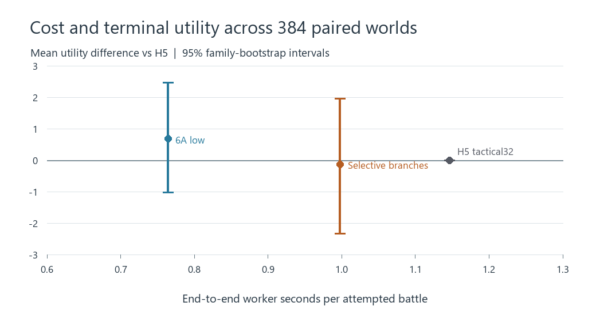

# M1-CORE-6B.2 回合内选择性分支搜索

**选择性分支解决了 B2 的候选遗漏，独立整战未通过基线升级。** 在 192 个新构筑族的 384 个配对世界上，新搜索取得 170 胜，实测成本匹配对照 H5 为 169 胜；356 个共同终局的平均效用差为 −0.13，按族重采样的 95% 区间为 [−2.33, +1.95]。新搜索每场比 H5 节省 12.9% 计算，但比 6A low 多用 30.6%，相对 low 的平均效用差为 −0.80。保留分支实现作为覆盖研究资产，完整基线继续采用 H5，快速对照继续采用 low。

## 搜索改动与冻结边界

研究起点为 CORE `33bb618bd9c0d1514542ba9925246a9784f9e466`，后端为 INFRA `80ca8165fee768ba4e2b55bfd367ee00df650616`。H5、G2、PublicGuide、V2、开战效用、C 边界及零裕量沿用 6A。每次决策仍先求 G2 参考。参考开放时，沿用低成本搜索的整回合直接 G2 回退。参考闭合时，保留原 6A 全部提案，在原本已计算的参考内部尝试以下偏离。[事前协议](../experiments/m1-core6b2/protocol.md)

1. **目标分支**读取参考在当前回合实际展开的公开反馈菜单。若 G2 的首选行动指向敌方，在同一手牌实例上枚举其他合法目标。先考虑公开伤害预览足以覆盖当前 HP 与格挡的目标；无预览也可成为候选。按原 G2 顺序打破并列，整次查询最多四个不同的「菜单、替代动作」组合。在目标数较少时可覆盖所有目标。
2. **一般分支**另外容许最多两个不同的中间操作。从 G2 排序取首个不同于上述换目标、也不同于结束回合的合法替代。待选、带抽牌预览、X 费及与原行动费用不同的机会优先。它可在抽牌、击杀或变费后出现的公开菜单上偏离；本版偏离的起点限于 G2 参考路径。每个新候选保留其余观察下的 G2 续法，原低成本组合仍提供 learned-follow 等续法。
3. **简单扩张对照**沿用完全相同的低成本首动作集合，再各加 build、end 两种原样式。`target`、`general` 和 `expand` 分别取得独立实验身份，完整代码哈希及上游策略身份随每个收据保存。[通用提案规则](../experiments/m1-core6b2/proposals.py) · [搜索和观察绑定适配](../experiments/m1-core6b2/branch.py)

候选生成只读取冻结接口给出的公开菜单，采用当步的卡牌实例和目标索引。偏离后重新从合法菜单行动，死亡敌人的旧索引不会沿用。每条机会分支单独沿公共观察路径传递“是否已偏离”，最多偏离一次。抽牌分叉前无需预知结果，仅在实际匹配的公开观察上替换动作。引擎仍生成完整条件程序、已解叶的原始概率和未解质量，执行时按原生的父节点及公开观察戳绑定。V2 只评价 C 和终局。

重用参考的菜单发现及冻结 V2 缓存。后端未提供可复用的任意候选内部快照句柄，每次偏离从同一根用原搜索接口重放公共前缀，其规则步数计入成本。仅在同根、已闭合、完整观察绑定树完全相同时去除重复程序。不同树若有同一完整后继分布，可以共享效用，仍分别计入程序覆盖。批量备份中先为同首动作的兄弟图分配不同临时槽位，再恢复合法首动作索引，避免不同图的叶互相覆盖。预算 32 是每图规则调用上限。

## 40 个历史开放根

下表计数先在各根内部去重再求和。候选数排除另求的参考；闭合树、闭合后继分布和步数包括参考。未纳入候选表的重复图仍计费。秒数为在相同根上只运行对应搜索与诊断记录的耗时，战斗端到端计时另列。

| 搜索 | 候选数 | 闭合候选 | 不同闭合树 | 不同闭合后继分布 | 规则步数 | G2 推理行 / V2 请求行 | 搜索秒 |
|---|---:|---:|---:|---:|---:|---:|---:|
| H5 tactical32 | 1,356 | 866 | 589 | 380 | 11,440 | 244 / 1,471 | 10.17 |
| 6A low | 220 | 199 | 143 | 105 | 1,636 | 244 / 329 | 4.55 |
| 目标分支 | 242 | 221 | 165 | 122 | 1,801 | 336 / 382 | 5.66 |
| 目标＋一般分支 | 269 | 244 | 188 | 135 | 2,101 | 514 / 438 | 7.89 |
| 简单扩张 | 414 | 375 | 219 | 165 | 2,640 | 244 / 546 | 5.50 |

相对 low，每增加 100 个规则步，目标分支、目标＋一般分支、简单扩张分别多覆盖 **10.3、6.5、6.0** 个闭合分布。按实测搜索时间，简单扩张增加 60 个分布仅多用约 0.95 秒，原生固定续法在这个口径很有优势。一般分支增加 30 个分布，多用 3.34 秒。它的价值集中在少数根：按最佳闭合候选比 low 至少高 0.001 效用计，目标分支改进 1 根，一般分支改进 4 根，简单扩张改进 2 根。不能由候选数或模型分数推断整战收益。[逐根程序、分布身份与成本](../experiments/m1-core6b2/evidence/regression.gz)

| 历史类别 | 根数 | 开放参考 | 一般分支新增的闭合分布 | 最佳 V2 估值实质提高 |
|---|---:|---:|---:|---|
| 人工 | 4 | 2 | 7 | B2，+42.62 |
| 敌人 | 8 | 3 | 8 | enemy-06，+12.08 |
| 抽牌 | 8 | 3 | 4 | draw-02，+2.91 |
| 组合 | 8 | 4 | 5 | 无 |
| 普通 | 12 | 2 | 6 | ordinary-05，+0.30 |

**B2** 中 G2 参考和新程序均先打铜墙铁壁+。目标枚举自动生成了打中、右、左敌的不同续法。受控根无需增加首动作：参考击杀中敌，价值 −0.86；新选中程序击杀右侧成长敌人，价值 41.76。两者均闭合且玩家进入下一回合时均为 35 HP。原 H5 最佳为 1.07。低成本原有 7 个候选；仅目标分支增加 3 个图和 12 个规则步，一般分支额外探测后合计增加 20 步。6B.1 人工程序的 49.35 分属于另一套后续操作。新搜索的提案器没有使用人工程序、牌名或敌名。[6B.1 受控实验](m1-core6b1-strategic-diagnosis.md)

**B1** 的一般分支把根内不同闭合分布从 5 个扩至 8 个，最佳方案保持先防御的 learned-follow，估值 61.32。当前实现只在参考首动作之后偏离，无法找回在首动作剪枝中被排除的耸肩起手。**A、B3** 原有参考仍分别因回合开始能力和自定义卡牌的未建模随机而开放。新搜索在两根均零提案，直接 G2 回退。40 根中 14 个开放参考全部维持此行为。

用 6B.1 的原世界及同八个重排世界执行 B2 自动生成的闭合程序，回合后均接冻结 H5。新程序打铜墙铁壁+、全身撞击右敌、铁斩波攻中敌、结束；右敌死后，铁斩波以当时合法菜单索引 1 绑定中敌。原参考的铁斩波也是索引 1，但中敌已死，实际绑定右敌。原世界新程序以 16 HP 获胜，参考死亡。八个重排中新程序 **8 胜、平均效用 76.63**，参考 **3 胜、平均 −9.75**，配对差 **+86.38**。撞左再续 G2 取得 2 胜；保持撞中而将最后的铁斩波换到左敌为 0 胜。四套程序的批量估值均经逐图重算。这里是同一历史根的机制回归。[逐步行动、law、V2 和四方案终局](../experiments/m1-core6b2/evidence/b2-paired.gz)

另在 enemy-01 取得条件程序见证。五个 C 后继各占 0.2，恰有一支在观察揭示后改目标，其他四支沿 G2。独立单图复算完整期望效用 73.49。整个 40 根面板里，H5、low、目标分支、一般分支、简单扩张平均每个提案的未解概率质量分别为 34.92%、9.24%、8.40%、9.01%、9.06%；开放参考导致低成本路径直接跳过许多困难查询，比较闭合率时需同时看提案分母。[条件树、叶概率与偏离位置](../experiments/m1-core6b2/evidence/conditional-check.gz)

## 开发选型与独立面板

开放开发使用 5G 的前 32 个固定世界，五臂顺序单 worker 运行，每臂均严格完成 32 场。端到端成本自解释器导入开始，包括搜索、模型推理、完整公开轨迹写出和离线准入核验。

| 开发臂 | 全尝试胜场 | worker 秒/尝试 | 新分支实际改行动次数 |
|---|---:|---:|---:|
| H5 tactical32 | 13/32 | 1.472 | — |
| 6A low | 14/32 | 1.040 | — |
| 目标分支 | 14/32 | 1.077 | 3 |
| 目标＋一般分支 | 14/32 | 1.298 | 8 |
| 简单扩张 | 14/32 | 1.072 | — |

一般分支相对仅目标分支的开发配对效用高 0.25，结合 B2 回归按协议选择 `general`。三个既有/简单扩张对照中，开发成本最接近它的是 H5，故确认只需 H5、low、general 三臂。0.25 来自小面板，选型本身没有提供独立收益证据。[首次确认前的选型、身份与调度](../experiments/m1-core6b2/evidence/selection.json)

按无序牌组成分排除 7,896 个历史构筑指纹，覆盖 2A 所有预分配、历史失败与储备、CORE-0 的 48 个基准族、5G、5H、6A 和 6B.1。仅取封存名单的开局牌组做排除。新面板固定 192 族、各两个种子，共 384 个世界，覆盖 63 种遭遇。第一至三幕分别 65、64、63 族，开战 HP 为 44、64、80 的分别有 63、67、62 族。普通合成 64 族、协同合成 63 族、foundation 非 Ancient 随机池 65 族；30 个构筑含原生声明的多人专属牌。每族标出来源和牌名。结果适用于这个合成域。[冻结开局面板](../experiments/m1-core6b2/evidence/confirm.gz) · [历史排除及来源计数](../experiments/m1-core6b2/evidence/panel-audit.json)

## 独立整战与能力—成本验收

每臂均实际尝试 384 场，分六片，每片 64 场；三 worker 交错运行。严格完成要求程序与真实公开观察及 C/终局 law 匹配，并通过冻结经验读取与公开轨迹核验。胜率使用全尝试分母；战损按各臂严格终局统计，死亡或损失开战 HP 的至少一半算严重战损。耗时包括导入、搜索、压缩实际轨迹及读回。

| 策略 | 全尝试胜场 | 严格完成 | 平均净战损 / 严重场数 | worker 秒/尝试 | 合格场/worker 分钟 | 合格 C |
|---|---:|---:|---:|---:|---:|---:|
| H5 tactical32＋V2 | 169/384（44.0%） | 356/384（92.7%） | 45.82 / 263 | 1.146 | 48.5 | 1,698 |
| 6A low | 173/384（45.1%） | 358/384（93.2%） | 45.79 / 265 | 0.764 | 73.2 | 1,689 |
| 新选择性分支 | 170/384（44.3%） | 357/384（93.0%） | 45.71 / 262 | 0.998 | 55.9 | 1,673 |

| 新搜索相对 | 共同终局 / 构筑族 | 平均配对效用差 [95% 区间] | 共同终局翻赢 / 翻输 | 同胜场 / 平均战损差 | 端到端成本比 |
|---|---:|---:|---:|---:|---:|
| H5，事前成本匹配对照 | 356 / 184 | −0.13 [−2.33, +1.95] | 5 / 5 | 164 / +0.09 HP | 87.1% |
| 6A low | 357 / 184 | −0.80 [−2.25, +0.47] | 1 / 4 | 169 / −0.18 HP | 130.6% |

以构筑族为单位重采样 10,000 次，两种子和各策略一起抽取。相对 H5 全尝试多 1 胜、多 1 场严格完成，成本比低于 110%，但效用区间下界 −2.33 未达到大于零的升级要求。三臂都完成的 356 个世界上，新搜索相对 low 的效用差仍为 −0.81。当前证据也不足以把它列为已验证的高能力教师。[配对统计、区间及验收判定](../experiments/m1-core6b2/evidence/results.json)

**新增分支的实际利用。** 新搜索在 2,111 次查询中取得 1,280 个闭合参考，有 831 次直接回退。在闭合参考处选中新增程序 82 次（6.4%），其中目标分支 26 次、一般续法 56 次。将选中程序和该根原 low 最佳程序按实际公开路径逐步比对，81 次遇到不同的合法行动，24 次在首动作、57 次在回合内部。其余一次选中不同程序，但实际轨迹未见不同动作。首动作改变来自改选了以 G2 首动作起始的整套程序，新增规则本身只在中间节点偏离。

| 确认搜索 | 查询 / 开放参考 | 候选 / 闭合候选 | 计入的规则步数 | G2 行 | V2 请求行 / 批次 / 实际推理行 |
|---|---:|---:|---:|---:|---:|
| H5 | 2,138 / 844 | 60,600 / 40,587 | 483,395 | 14,127 | 57,157 / 8,008 / 27,100 |
| low | 2,124 / 831 | 11,181 / 10,364 | 69,223 | 13,958 | 13,617 / 4,404 / 7,039 |
| 新选择性分支 | 2,111 / 831 | 12,855 / 11,971 | 80,692 | 20,205 | 16,639 / 5,849 / 7,998 |

规则步数统计已返回查询中的参考、候选及已计算后去重的图。新搜索实际探测 2,174 个偏离图、12,996 步，其中 375 个闭合重复图消耗 1,697 步。阶段异常前未返回的工作只能由端到端计时覆盖。相比 low，增量不仅包括规则步，还包括新的公开反馈交互和 G2 推理。确认各臂经历的战斗路径不同，单位预算分配的对照应看上面的同根回归。

| 失败原因 | H5 | low | 新选择性分支 |
|---|---:|---:|---:|
| 实际观察不在已评价程序中 | 13 | 12 | 13 |
| 实际边界不在预测 law 中 | 4 | 3 | 3 |
| 随机插牌涉及已知位置 | 3 | 3 | 3 |
| 从抽牌堆直接移牌 | 7 | 7 | 7 |
| 数组索引越界 | 1 | 1 | 1 |
| **全部失败** | **28** | **26** | **27** |

所有失败均保留在胜率、完成率和成本分母，终局效用留空。开发域还以 6A 原有收据交叉核验了 H5 和 low 各 32 场的胜负、终局 HP、行动数、查询和闭合数。冻结宿主、规则库、游戏二进制及模型身份均经核对。[经验收据与完整性核验](../experiments/m1-core6b2/evidence/audit.json)

## 计算账本、复核与后续边界

| 阶段 | worker 秒 |
|---|---:|
| B2/B3 轻量回归、40 根五臂回归 | 5.26 + 39.14 |
| 32 个开发世界、五臂完整生产 | 190.71 |
| 独立面板构造 | 0.80 |
| 独立确认，384 世界 × 三臂 | 1,116.99 |
| B2 四方案实际续战、条件概率见证 | 21.90 + 4.23 |
| 配对分析与证据核验 | 2.22 + 3.77 |

实测合计 **23.08 worker 分钟**，另留 3 分钟计入解释器启动、绘图适配重试、清单及最终检查，合计 **26.08 worker 分钟**。确认阶段三 worker 的实际 wall time 为 399.47 秒。既有经验已足以完成 192 族的预定面板，未追加模拟。[分阶段账本](../experiments/m1-core6b2/evidence/ledger.json)

仓库根执行 `python -B experiments/m1-core6b2/verify.py` 可直接核对提交内的文件哈希、策略身份、面板、失败分母与总账本，无需启动引擎。重做模拟时从冻结起点建立独立 CORE 工作空间，放入本实验源码和协议并使用新的本轮输出目录，提供同级冻结 INFRA、6A 及 6B.1 的输入资产。依次执行本实验的 `regression.py B2 B3`、`regression.py`、`battle.py dev <臂> 0`（low、general、v2、target、expand）、`panel.py 192`、`campaign.py`、`b2_replay.py`、`conditional_check.py`、`analyze.py` 和 `verify.py --seal`。确认前锁定的身份、开局与分片顺序可单独复查。原始自然账本和公开决策流位于 CORE 的 `logs/core6b2/<阶段>-<臂>-<分片>/`，其哈希随收据入库。[实验与复现入口](../experiments/m1-core6b2)

**研究决策。** 保留同首动作目标分支、公开观察偏离及其成本对照，不升级生产基线。后续 6B.3 可优先在开放参考处公平比较实际回退与候选，并区分搜索未闭合与执行绑定失败。6B.4 再检验选择性多回合教师是否有独立收益。两项均留待另行立项。
