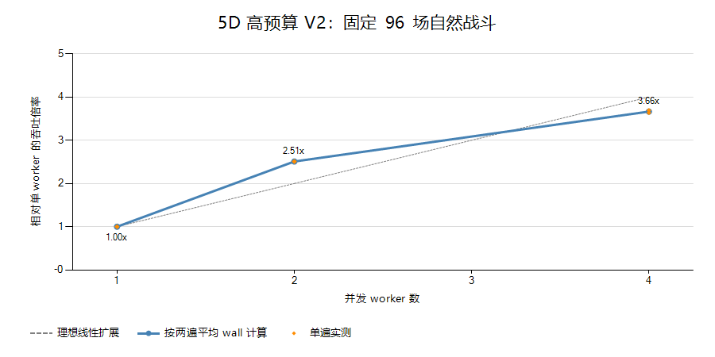

# M1-INFRA-0 端到端经验生产性能基线

## 0B 结论

**INFRA-1 首项建议是做现行 C# 宿主的参考转移批处理原型，保持冻结的搜索顺序和预算。** 5D 高预算自然面板的第一遍 Aggregate 中，141,103 条参考 RPC 占 216.02 秒，整批为 444.35 秒。5E 三种真实负载合计有 73.7% 的 wall 用于首方案执行后的 V2 续战，整组共享的初始候选已经存在。两种负载都能用于验收同一搜索改动。设计、可移除工作量及正确性门槛见[INFRA-1 设计](../experiments/m1-infra0/evidence/formal/infra1-design.md)。

### 端到端结果

| 负载（单 worker） | B/A 遍数 | Baseline 均值 s | Aggregate 均值 s | 实测计量差 | 有效产出 / wall s |
|---|---:|---:|---:|---:|---:|
| 5D 自然 V2 | 2/2 | 447.58 | 447.73 | +0.03% | 0.214 战斗 |
| 5D 反事实 V2 | 2/2 | 167.19 | 171.89 | +2.81% | 0.191 完整对 |
| 5E 训练初采 V2 | 2/2 | 74.02 | 79.00 | +6.72% | 0.594 准入世界 |
| 5E 开发初采 V2 | 2/2 | 87.74 | 95.48 | +8.83% | 0.365 准入世界 |
| 5E 独立复评 V2 | 2/2 | 157.45 | 162.37 | +3.12% | 0.305 准入世界 |
| 5D 自然 V2low | 2/2 | 281.24 | 324.11 | +15.24% | 0.341 战斗 |

开销为同面板 Aggregate 平均 wall 除以 Baseline 平均 wall 再减一。顺序交叉仍有机器时段差异。吞吐取原生产 Baseline，阶段占比从 Aggregate 的本遍 wall 计算。低预算自然两遍 Aggregate 分别为 275.78、372.43 秒，两遍 Baseline 为 266.07、296.41 秒。该档 +15.24% 的观测差受时段波动影响，不宜当成固定探针成本。

自然战斗的 96 根全部抵达合格终局。高预算取得 513 个实际 C、2,503 个合法决策、3,225/4,852 个完整/尝试策略；同权重低预算取得 511 个 C、2,499 个决策、2,402/3,680 个完整/尝试策略。低预算改变搜索工作量。44 个反事实任务有 32 个完整对，16 个包含自然终局复用、16 个需要两侧续战。另有 7 个未完整匹配和 5 个无不同完整方案的任务，均计入端到端时间。总共生成 78 个完整条件方案、取得 68 个匹配侧。第一遍 Aggregate 中，反事实 fight 占 119.98 秒，menu 占 37.97 秒，restore 占 5.01 秒；四份父轨迹的 256 行扫描耗时约 0.15 秒。分层吞吐、CPU、各进程峰值、首根和 P95 见[正式指标表](../experiments/m1-infra0/evidence/formal/tables.md)。

### 5E 固定成本与逐世界工作

训练面板取自原 128 根，开发面板取自原 48 根。复评取原 12 个高方差根中的 6、57、123 和 4 个全零根中的 13。每个编号沿用原 12 世界协议。真实失败包括无可用根、未完整匹配、牌堆实例 law 不符，以及续战遇到 stable source 异常。失败发生前的建根、重排、执行、关闭和下一次重建都在整任务计时内。原始根编号、分层分母及输入哈希见[冻结面板](../experiments/m1-infra0/world-panel.json)。

| 首遍 Aggregate | 尝试/有效根 | 启动/双侧返回/整根准入世界 | 根级固定 s（其中 menu） | 世界侧 restore s | V2 续战 s | 续战占 wall |
|---|---:|---:|---:|---:|---:|---:|
| 训练初采 | 12/8 | 50/48/44 | 24.81（15.8） | 3.35 | 38.53 | 49.5% |
| 开发初采 | 6/4 | 33/32/32 | 6.3（3.2） | 2.9 | 80.24 | 80.6% |
| 独立复评 | 4/4 | 48/48/48 | 12.3（9.3） | 2.70 | 131.54 | 80.9% |

全部 22 个尝试根中 16 个整组准入。三组共有 131 个启动世界、128 个双侧返回世界、124 个两侧均匹配的局部有效世界。本面板的 124 个局部有效世界恰好全部进入完整根，生产代码仍分别核对局部匹配和整组准入。259 次侧尝试中有 258 次调用后续 fight，256 次返回终局，其中 212 次返回前实际执行了新决策。已返回的续战含 1,604 个决策、486 个有搜索的回合、205,709 次模拟调用。按三组首遍 Aggregate 的 339.85 秒合计，实际 fight 调用为 0.759 次/秒，有决策的完整续战为 0.624 次/秒。异常调用的耗时计入阶段，无法从未返回的结果补记其完整回合统计。

训练 4 世界分层每启动世界的边际耗时均值为 1.52 秒，训练 8 世界为 0.16 秒，开发 8 世界为 2.56 秒，复评 12 世界为 2.83 秒。复评的中位数为 0.51 秒，最大为 13.85 秒；仅根 123 即用时约 119.8 秒。已有方案与根、成功率及余下战斗长度同时变化，分层均值不能解释为只改变世界数的因果效应。整批分母还纳入模型/宿主启动、构建父轨迹索引、文件写盘和关闭。逐根固定计数、逐侧阶段和原始经验位于[收据包](../experiments/m1-infra0/evidence/formal/production-receipts.zip)。

### 调用链、身份与语义

生产仍执行 `conditions5e.run → choose_root → restore → menu/pair`。候选回合满足可交换条件后，完整候选与执行见证在同根共享。每个世界的每一侧随后执行 `restore → diagnostic_world → project/公开 law 核对 → realize → fight → reset`。首回合打完即终局时，调用 fight 可以零决策返回。审计先在原开放训练全集上执行 followup，再对冻结四根重新生成候选并比对原 public 和完整方案 law。重排只作用于合法可交换的未知牌堆，其他随机流保持原合同。详见[条件世界协议](../experiments/m1-infra0/world-protocol.md)。

5D 起点为 `5bb7c68bbb66e25b419460743d09f74568ca3372`，0B 起点为 INFRA 提交 `cd011d0179638ffecb5cf37440ac04df41fc6811`，5E 只从 `70e2e28b2915b962e93e3b30d3ec41aa5875fc6f` 选择性导入生产文件与开放归档。5D 与 5E 高预算使用相同冻结 V2、G2 与规则。5E 原始 Headless 为 `fd61e5f5…a000e0`，5E 计量 Headless 为 `262251db…effad`；二者使用同一 Solver `29f48500…9a36a2` 和 Godot `e18cd7a2…a6783610`。5D 使用独立的一对宿主。构建从冻结 PDB 核对宿主源码，再对 5E 自己的 Headless 加计量。源码、输入与部署身份分别见[原始导入](../experiments/m1-infra0/evidence/formal/world-inputs.json)、[计量构建](../experiments/m1-infra0/evidence/formal/meter-host.json)和[实际部署 SHA-256](../experiments/m1-infra0/evidence/formal/deployment.json)。

公开语义夹具用训练根 75 的 4 个世界、8 个方案侧比较 Baseline/Aggregate，149 个公开事件逐项完全相同，包括实际动作绑定、候选 law、重排后的公开状态及信念和终局。共校验 31 个有生产收据的 treatment，规范 JSON 仅剔除顶层计时字段，跨计量模式、重复与并发分片均精确相等。有同源高预算历史归档的 27 个 treatment 也逐行还原原结果。V2low 在本轮同一低预算负载内交叉验证。三章原生重载分别用时 2.43、2.26、2.68 秒，3/3 的原生状态与参考相同，单列于预测生产吞吐之外。公开事件、规范记录及原生匹配分别见[语义夹具](../experiments/m1-infra0/evidence/formal/world-check.json)、[逐 treatment 校验](../experiments/m1-infra0/evidence/formal/verification.json)和[原生重载](../experiments/m1-infra0/evidence/formal/native.json)。

定向 Diagnostic 对原四个复评根运行 cProfile，产物逐行相同，wall 为 187.34 秒。函数 self/cumulative 受详细剖析影响，只用于定位。[诊断函数](../experiments/m1-infra0/evidence/formal/diagnostic-functions.json)

### 并行扩展、预算与限制

同一 96 根高预算自然工作量的 1/2/4 worker 平均 wall 分别为 447.58、178.43、122.17 秒；2/4 worker 的吞吐倍率为 2.51、3.66，并行效率为 125.4%、91.6%。2 worker 各遍为 178.22、178.64 秒，4 worker 各遍为 123.12、121.21 秒。4 worker 取得最快整批 wall；2 worker 平均花费 354.33 个生产 worker 秒，4 worker 为 397.53 秒，缩短工期的同时多花 12.2% 的累计 worker 时间。4 worker 首遍各分片为 106.5、123.1、93.1、77.1 秒，尾部受最长分片限制。4 worker 的单个 Python/宿主峰值为 344.1/243.5 MiB。峰值来自独立进程，不能直接加成同一瞬间的整机峰值。实测 PyTorch intra-op 为 1，interop 为 12；分片进程拥有各自的推理及前缀缓存。报告的是本机固定面板的短程结果，档位和时间顺序、分片缓存及机器状态对超线性读数的贡献尚未分离。

统一账本实耗 **112.66 / 120 worker 分钟**，余额 7.34 分钟。按不重叠阶段列账如下。

| 阶段 | worker 秒 |
|---|---:|
| 各负载首轮单 worker 正式对照 | 2449.0 |
| 首次并行扩展 | 757.8 |
| 反向及扩展复测 | 3316.8 |
| 审计 Diagnostic | 188.2 |
| 5E 计量宿主构建 | 11.7 |
| 5E 轻量语义检查 | 28.9 |
| 三章原生重载 | 7.6 |
| 失败 treatment | 0.0 |

按负载重看同一账本，5D 共 86.70 分钟，5E 含轻量验证和诊断共 25.64 分钟，构建与原生重载另列；两个口径不能相加。预算扣款用 worker 从启动至退出的累计时长，主吞吐则在完整 gzip 关闭可读处截止。离线代码编写、资产准备及事后归档校验不计生产 worker 时间。所有冻结根均保留，生产记录内的失败计入所属 treatment。未运行更高并发、长时故障率试验、全体 5E 人口或候选快照实现。见[统一账本](../experiments/m1-infra0/evidence/formal/campaign.json)与[分项成本](../experiments/m1-infra0/evidence/formal/budget.json)。

### INFRA-1 实施顺序

1. 实现现行宿主对独立、已就绪的公开参考分支的批量查询，复用既有前缀缓存。高预算自然的参考调用包含 155.54 秒宿主处理、25.59 秒两端 JSON、34.88 秒未分解的同步与其他成本。理想消除全部非 handle 时间的单项上限为整批的 13.6%，约 1.16 倍；保留宿主必要工作后的实际收益需原型验证。
2. 保留固定工作量的进程并行，并以 C 导出/回包、公开前缀句柄、G2 调用为下一批诊断对象。高预算自然的 19,987 次 G2 前向均为 batch 1，耗时 53.29 秒；V2 前向仅 1.51 秒，而 V2 编码为 11.13 秒。批量推理需要原顺序回填、逐步核对概率与候选排序。压缩写盘的独立耗时在此硬件和面板上很小。
3. 中盘根和条件世界快照保留为有界的正确性研究。259 次侧建根、3,040 步重复前缀总 restore 为 8.95 秒，第二侧重复重排共 0.155 秒。即使全部省下这两项且分叉免费，对三组 5E wall 的收益上限也只有 2.68%，约 1.028 倍。需隔离环境对象、动作绑定、RNG、公开 PileLaw、G2 历史和原生句柄生命周期。当前证据足以启动现行宿主的等语义批处理，HotKernel 整体迁移的端到端收益仍待同语义转移对照。

## 0A 历史记录（正式测量前）

从 CORE-5D 提交 `5bb7c68bbb66e25b419460743d09f74568ca3372` 建立独立 worktree 和 `research/m1-infra`。本阶段交付生产测量入口、冻结面板和轻量等语义证据。正式端到端基线、观测开销、扩展曲线及 INFRA-1 排序待 0B。运行命令与计量合同见[冻结协议](../experiments/m1-infra0/protocol.md)。

### 环境与隔离

本机 i5-13500H、16 个逻辑处理器、约 31.6 GiB 内存，Python 3.10.11、Torch 2.12.0+cpu，运行 CoreCLR 9.0.7，构建 SDK 10.0.404。游戏版本 0.113.1 / Build 26660232，安装目录下的 sts2.dll 与运行副本均为 `62ecbe91…4a9c3`。正式基础 Solver 为 0.51.5-iik.3b，哈希 `b4db8cae…181c53`。5C 覆盖层的 build.json 保留版本字符串 0.51.5-iik.3b.sv1。实际 lane 握手核验 solver-bin/CombatSolver.dll 为 `80fc3a14…840ab4`，冻结 Headless 为 `a3dae1f9…f5968`，GodotSharp 为 `d6dd03e7…d509362`。计量版只重新编译 Headless，逐一校验 28 个生成的 C# 源文件的 SHA-256 在冻结 portable PDB 中存在，并用冻结 Godot 和 Solver 链接。G2 与 V2 权重分别为 `1077c191…bf084` 和 `d439444a…fcbbb`。完整身份见[运行环境](../experiments/m1-infra0/evidence/environment.json)和[输入清单](../experiments/m1-infra0/evidence/inputs.json)。

- 历史构建的 csproj 含指向原仓库 lib 和 solver-bin 的绝对路径。新构建逐项改为 INFRA 内的副本，NuGet 仅从私有目录内的四个本地 9.0.23 引用包还原。第一次开发构建尝试默认 NuGet 源失败，后来验证了离线构建路径。首次 dotnet CLI 初始化报告安装开发证书；后续构建已禁用首次生成证书并将 CLI 和包缓存指向独立目录。
- `build_host.py` 的直接入口可复用 core2-state03；`host5c.py` 将 build.extension 接到 5B→5A→CORE2→CORE1R2，再由底层构建基于 n4b-host-v2、SV4A 等历史目录准备源码和二进制。5D 训练复现脚本还会派发多个进程并训练。0A 使用有冻结身份的运行资产，无须启动该脚本或改写历史构建。
- INFRA 仅从显式列表复制历史运行目录，未链接原 logs，未使用 CORE-5E 工作文件。旧版基础 Solver 和 RitsuLib 保持只读，记录 compat、shared 和根目录候选文件。每个 worker 独占 cwd、临时目录、缓存与输出；EngineClient 给每个子进程单独分配 profile、AppData 和临时目录。通信为 stdin/stdout，没有 TCP 端口。CORE-0 封存集未作为实验输入。原生存档、种子及父轨迹均在环境/测量侧，搜索使用原生产公开投影。性能计数由外层收集或留在宿主旁账。

### 源码级生产调用图

| 调用点 | 下一层与实际工作 |
|---|---|
| 5D battle5d.run → configure(V2/V2low) | 5C complete.setup → 5B deploy5b.init → N4B design.runtime 加载 G2 并校验历史 Host，临时绑定 5B 后关闭，最终用 host_at 创建 5C Host。5A-host3 是 G2/G2search 等旧臂的支路。名为 high 的 5B 臂也与 5C 高预算 V2 有不同的搜索合同。 |
| SV4A loop_battle.Host → PRE1 evaluate.bind → PRE0B run.bind_host | II-K.4B 基础身份、PRE0B Host、N4B/5B/5C 运行清单相继核验。Lane.open 延迟拉起 OfflineSearchHarness，握手再发 i1_s3a_identity。Lane.reset 在复用期内发四条释放/退役命令，达到 256 根则回收。异常处理会关闭 lane，下一个根再拉起。 |
| CORE4 play_loop.fight → cohort.start / step | pre0_start 在实际游戏规则下建合成世界，进入预测 episode；i1_n2_step 执行真实选定的合法动作。每回合初调用 Planner，可采用完整方案或回退 G2。终局、实际 C、查询和实际动作轨迹随每根 gzip JSONL 刷新。 |
| 5C complete.Planner → CORE4 improve.graph_plan | i1_core1r2/reduced 生成约简图；CORE5A search5.reference 以 G2 队列沿公开结果推进；settle_batch 共享查询内公共前缀，估值后按概率回传。合法采用要求候选和参考质量完整，候选效用超过参考加 1。 |
| 5C Turn.search → follow → outcomes → read | 先查 Python route cache，然后以 i1_core5_reference 请求 5C 公开转移。生成候选、处理待选和多抽等价约简，score 和 backup5c.combine 按同一公开观察组合，program 编译，execute_program 按实际观察匹配合法动作。finally 发送 clear。 |
| Reference.cs → TacticalFork / PileLaw.Fork / InteractiveCombat | 从同一真实 source 的最长已缓存路由前缀恢复。使用 complete namespace，缓存至多 48 个快照，逐出时释放；公开事件、战略 C、终局或未支持边界会提前返回。因此路由长度减命中长度也不能替代实际回放次数。Tactical.cs 的批量结算缓存另有作用域。 |
| search5.Evaluator → semantic.encode → SHA-256 → cache → pack → Value.forward → expected | 动态机制行使用 16384 项 cached_row；概率缓存为单模型 2048 项 LRU。命中前仍须编码并构造张量字节键。同 batch 重复可合并；不同开局付费 HP 在获得概率后换算。G2 使用 Controller.score、encoder、tensors 和另一张网络。 |
| 5D experience5d.run → sample → restore → options5d.menu/pair → realize | 从父轨迹筛至最多 3 个回合，分别从开局复放至目标；同次查询取得完整候选。第二侧重新建根。实际回合动作与自然轨迹匹配时可复用自然终局，否则 fight 从当前状态续战。保留无对、执行缺口、不匹配和自然终局复用。 |
| teacher5d.run / reproduce5d.run | 独立教师探针对同一公开开局重排未知尾牌，成对执行预选方案；它与自然父轨迹的中盘反事实分母不同。reproduce5d 还做训练、选模、教师和原生核验，本次只调用自然及配对生产入口。 |

### 历史证据对照

| 研究资产与对应实现 | 证据口径 | 与当前生产的关系 |
|---|---|---|
| B1A / B1B 的 run_probe.py | B1A 两种人工根，常驻后续根中位 79 ms，逐根冷 3.37 s；B1B 含首次启动和退役的 24 根批次为 1.77 / 0.26 根每秒 | 证明宿主生命周期有影响。其根、策略及写出合同与 5D 不同，24 根不能确定长时稳定性。 |
| HK0、HK1A-Perf，hk1a/perf_overlay.py 和 perf_search.py | HK0 的 5 万次 Unpack、PlayCard、Pack、Hash 为 83,053 转移/s。HK1A 六根同工作量全搜索，4/8 线程求解提升 1.52/1.62 倍，冷求解加验证 1.16/1.18 倍 | 可复用固定工作量、区分 CPU 和 wall 的方法。HotKernel 的值复制与当前规则状态、RNG 和公开信念快照复制范围不同。 |
| HK1A-DC3A，hk1a/reference.py、Oracle.cs | 固定世界全信息 Oracle，历史 96 次结果中 42 条实际验证胜路有终局核对 | 可复用同根身份与独立重放；把私有未来用于公开策略会改变策略信息集。 |
| N2A，hotdraw/Resolver.cs、Belief.cs、Session.cs | 显式随机与选择转录、分支寻址及受限机制夹具 | 可复用公开事件和有序/无序等价验证。1.0.2 后端缺少现行 0.51.5 扩展的交互 ABI、完整 C 导出及同一合法绑定。 |
| SV4A，loop_battle.py、loop_policy.py | 相同开发根，G0 6.71 完整战斗/s，350 调用档 2.37/s。采集、推理与训练有独立账本 | 复用其常驻 Host、Lane 和公开控制器。历史搜索预算和网络输入不同。 |
| CORE5A，benchmark.py、search5.py | 52 开发族四遍整战，含启动与压缩写出；79.62→52.63 s，1.51 倍 | 批结算、编码与概率缓存组合已有证据，不能把组合收益拆成各项独立收益。 |
| CORE5C，complete.py、host5c.py | 24 个同根，5B 高档 30.8 s，5C 完整搜索 83.6 s；生成与待选有定向机制/原生证据 | 搜索工作量和结果都改变。采用 5C 高档 V2、冻结宿主与核验方法。 |
| CORE5D，protocol.md、evidence/ledger.json | 累计 6524.48 worker 秒；自然训练 2020.23 秒，配对 1250.82 秒；历史计时漏掉模块导入等。96 根高/低预算带来不同工作量 | 使用开放训练根和有效 C/完整匹配双终局准入。已有三个抽牌复放问题仍按旧基线计。5D 的修复宿主未引入。预测终局与独立原生核验分别记账。 |

### 实现与观测范围

三种模式均进入 battle5d.run 或 experience5d.run。对这两个文件的改动限于可选索引/父轨迹目录以及观测 gzip 刷新、关闭的回调。默认调用沿原有分片次序和写出格式运行。Baseline 使用冻结 DLL 和原搜索代码；Aggregate 用专用 Headless 旁账和 Python 分阶段计数；Diagnostic 另保存可用 pstats 打开的定向调用剖面。协议中的生产 wall、累计 worker wall、两类进程 CPU 均有独立字段。

- 规则工作可从实际决策、图节点/转移与结算调用、参考缓存命中深度、逐出、真正进入的复放边、fork、释放、敌方/结束回合结算与 C 导出下钻。计数边界为宿主交互动作，单个动作可触发多个战斗机制。宿主在 ready、退役、exit 记录进程累计 JIT 时间、方法数和 IL 字节，可比较首根与稳态增量。
- 每类 RPC 记录双向字节、Python 编解码与整次请求、宿主 parse/handle/serialize。另存前缀长度及返回大小分布。JSON 返回与底层缓冲之间的剩余等待归 residual。计时器无法独立确定某个缓存未命中带来的 OS 调度成本。
- 搜索记录保留候选/参考原始质量、预算缺口、候选数、完整方案数、采用、实际执行结果以及回退。Diagnostic 的递归/generator 展开见 pstats。根级资源来源、投影、规则查询、编码、缓存、同批去重、前向和概率换算均可追到实际调用。编码器内部的张量拷贝、敌方单个动作、Solver 深层信念更新仍可能含在父阶段；这些项目没有独立排他计时。
- 经验写出记录原始 JSON 字节、zlib compress/flush、底层 write/flush 和最终压缩大小；close 包含文本、gzip 和操作系统缓冲层中尚待完成的工作。父轨迹读取记录扫描的分片数、解码行数和读取时间。实测单个反事实任务就按现行生产流程扫描了 4 个分片、256 行。此数量本身无法确定其成本占比。
- 完整经验和逐任务/逐根/逐阶段旁账均保留。Windows 进程 I/O 含管道开销，GC/JIT 时间与工作负载可重叠。终止异常的宿主可能只有 Python 端 Windows 进程收据而缺少进程退出时写出的 .NET 旁账，这类行应标记覆盖缺失。

### 0A 验收

三种模式分别在同一天然训练根 154、同一配对任务 65 上串行执行。比较每次实际合法动作绑定、公开投影与信念、机制/战略 C、编译表，以及整份经验记录中除顶层 seconds 外的所有字段。采用规范 JSON 精确一致。自然根产生 34 个决策、6 个有效 C、60 个尝试方案与 44 个完整方案；配对任务执行两侧实际续战，两个实际后继均匹配，最终获得 1 个有效对。这是有限样本的语义核验，单次时长不估算正式开销。

两版宿主另运行 CORE5D 的 cases 和 relic 夹具，对照历史 audit.json。验证头槌置顶、待选、前缀恢复与有序/无序多抽，沿用历史概率断言。历史 5B/5C/5D 三套单测分别 8、5、7 项通过。原生独立探针逐章重载冻结地图存档并执行真实入场动作，3/3 核对敌人、HP、最大 HP、金币、牌组、药水及遗物。三个原生根合计约 6.81 秒。当前 5C 预测生产入口接受合成开局配方，没有等价的原生地图存档导入，故这三个根只计原生恢复和支持边界，未计为有效预测自然战斗。没有把这些构筑删去遗物或改写成合成测试。

[逐项验收与计算账本](../experiments/m1-infra0/evidence/acceptance.json)记录各试跑和启动失败。[原始账本压缩包](../experiments/m1-infra0/evidence/smoke-ledgers.zip)含六次最终运行的生产 gzip、公开动作摘要、进程和宿主计数、根级累计与分阶段汇总。未单独计时的项目包括工作树创建、依赖复制与验签、早期握手、部分模块导入及报告生成。开发中修正了测量模块名与已有 prepare 模块冲突、transport 加载顺序，以及把 Python tuple 与 JSON list 直接对比引起的假失败。对照修正后的规范内容哈希，两个历史夹具的输出均一致。

本阶段已计量 **514.87 worker 秒（8.58 分钟）**，含开发构建、失败试跑、重跑和轻量回归；正式实验为 0 worker 秒。下表为最终六次单根生产的任务 wall，包含冷启动和用于正确性验收的语义记录器。单根中出现的耗时倒挂不能解释为负开销。

| 任务 | Baseline | Aggregate | Diagnostic |
|---|---:|---:|---:|
| 自然根 154 | 12.43 s | 12.48 s | 13.95 s |
| 反事实任务 65 | 21.33 s | 20.67 s | 22.40 s |

### 0B 待验证的问题

待资源确认后先执行单 worker 高档自然与完整反事实的交叉对照，再执行低档及固定工作量扩展。报告须对照正常和困难分层，分别报告有效战斗、C、实际决策、有效条件后继、完整方案和匹配对的 wall/worker 率，并给出失败、尾部、首根及常驻区间。以下五项目前均保留不确定性。

| INFRA-1 决策 | 在 0B 中能改变优先级的证据 |
|---|---|
| 把条件搜索高频循环移入 C# | 对照 Python 递归编译的排他时间及每种 RPC 的 residual，并确认迁移后保持公开表、质量和门控。 |
| 分支句柄或快照复用 | 将实际前缀传输字节、已复用深度、额外 fork、实际 replay 与重复发生的成本合并评估；持续持有快照会提高宿主工作集。 |
| 迁移 HotKernel | 需要同一根、同一公开动作/随机/待选及恢复范围的差分验证，并确认规则模拟占足够端到端时间。 |
| 优先中盘快照 | 比较 restore/replayed_action、根初始化与两侧续战成本，再按实际配对产量换算可节约的 worker 秒。 |
| 编码、推理、存储或并发调度 | 比较缓存命中后残留的编码、真实 batch 分布、写盘/压缩、重复扫描以及多 worker 首尾不均和进程 CPU。 |

未运行正式性能面板。3–5 倍和 10 倍仍是研究目标。
